

# 🕹️ Arcade Buddy

### Your All-in-One Google Cloud Arcade 2026 Companion & Facilitator Hub

**Track Badges · Visualize 2026 Streaks · Calculate Points · Claim Swags · Climb the Leaderboard 🎁**

[✨ Website Overview](#-about-arcade-buddy) · [🖥️ Feature Showcase & Screenshots](#️-website-features--screenshots) · [📋 2026 Rules & Tiers](#-2026-arcade-rules--milestones) · [🤝 Community & Team](#-community--creators)

---

## 🎯 About Arcade Buddy

**Arcade Buddy** is a dedicated web companion built for learners and facilitators participating in the **Google Cloud Skills Boost Arcade 2026** program. Instead of manually counting badges across scattered pages, learners can connect their public Skills Boost profile to see real-time Arcade points, track Facilitator Cohort bonus milestones, explore active monthly games, audit completed and remaining badges, browse official swag drops, and monitor their standing on the community leaderboard.

---

## 🖥️ Website Features & Screenshots

### 1. 🏠 Home Hub & Live Top Performers Podium
The landing experience welcomes visitors with a crisp Google Cloud-inspired layout featuring:
- **Live Prize Counter Countdown**: Real-time countdown ticking toward the **January 7, 2027** Prize Redemption Window opening.
- **Quick Platform Metrics**: Highlights active community learners, hands-on challenge labs, community rating, and the four official swag tiers.
- **Top Arcade Performers Podium**: Showcases the Top 5 global learners on a tiered summit podium with League rings and direct access to the full rankings.
- **Mentorship, Community Links & Interactive FAQs**: Instant access to peer support channels, WhatsApp/community links, and quick answers to common questions.

  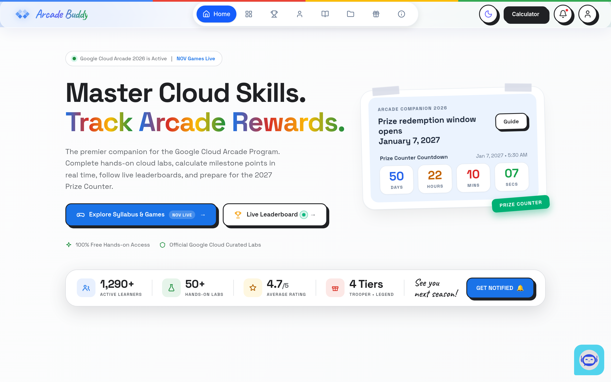
    
  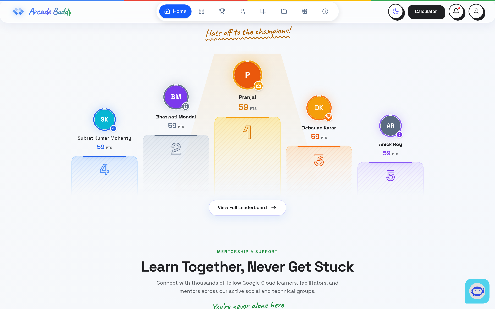

---

### 2. 📊 Personal Command Center Dashboard
Once a learner connects their public Google Cloud Skills Boost profile, the Dashboard transforms into a personalized tracking workspace:
- **Retro Welcome Hero & Swag Progress Notice**: Displays total Arcade Points earned, verified badge count, active streak, and exact points remaining to reach the next swag tier.
- **League Classification & Breakdown**: Automatically assigns **Bronze**, **Silver**, **Gold**, or **Diamond League** status alongside separate **Earned** and **Bonus** point counters.
- **Shareable Progress Poster**: Built-in **Create Poster** generator allowing participants to download and share custom milestone cards on LinkedIn and social feeds.
- **2026 Yearly Activity Heatmap Calendar**: Full-width **January through December 2026** contribution calendar with spaced monthly columns, active day counter, clickable day details, and a 6-color daily intensity scale:
  - **White** → `0 badges`
  - **Sky Blue** → `1–2 badges`
  - **Ocean Blue** → `3–4 badges`
  - **Deep Blue** → `5–8 badges`
  - **Green** → `8–10 badges`
  - **Deep Green** → `10+ badges`
- **Category Breakdown & Quick Badge Audit**: Summarizes **Skill Badges**, **Game Badges**, **Special Badges**, and **Work Meet Play** totals with a direct **Badge Tracker →** shortcut.
- **Unified Milestones Hub**: Interactive side-by-side cards switching between **Arcade Milestones** (`Trooper`, `Ranger`, `Champion`, `Legend` with live spot availability & modal item checklists) and **Facilitator Milestones** (`Milestone 1` through `Ultimate`), plus a **Cohort Registered / Standard Arcade** toggle.

  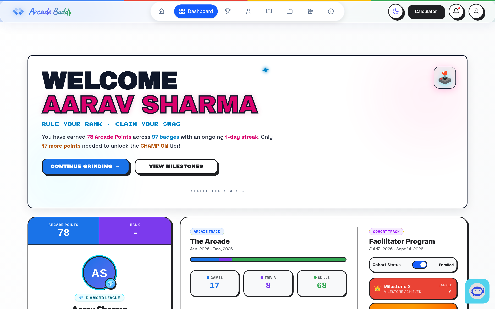
    
  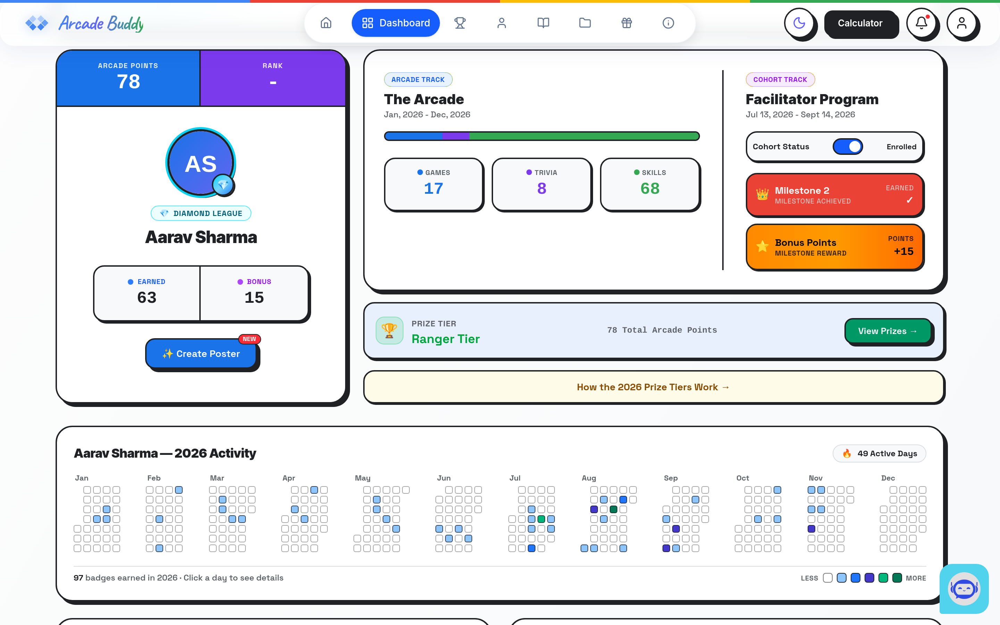
    
  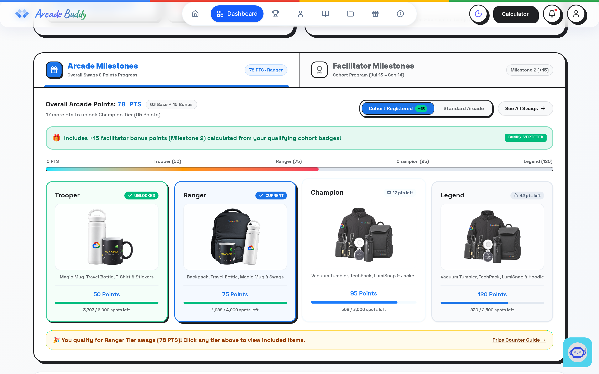

---

### 3. 🎯 Dedicated Full Badge Tracker Report
A dedicated inspection view built to eliminate confusion over which labs and games count:
- **Completed vs. Incomplete Tabs**: Switch cleanly between earned badges and remaining badges, or view both side by side.
- **Arcade vs. Facilitator Window Filtering**: Clearly separates badges valid for the full **Arcade 2026 Season (Jan 1 – Dec 31, 2026)** from those earned inside the strict **Facilitator Cohort Window (Jul 13 – Sep 14, 2026)**.
- **Large Visual Badge Cards**: Displays full-size official Google Cloud badge artwork, earned dates, point values, and direct links to start unfinished labs.

  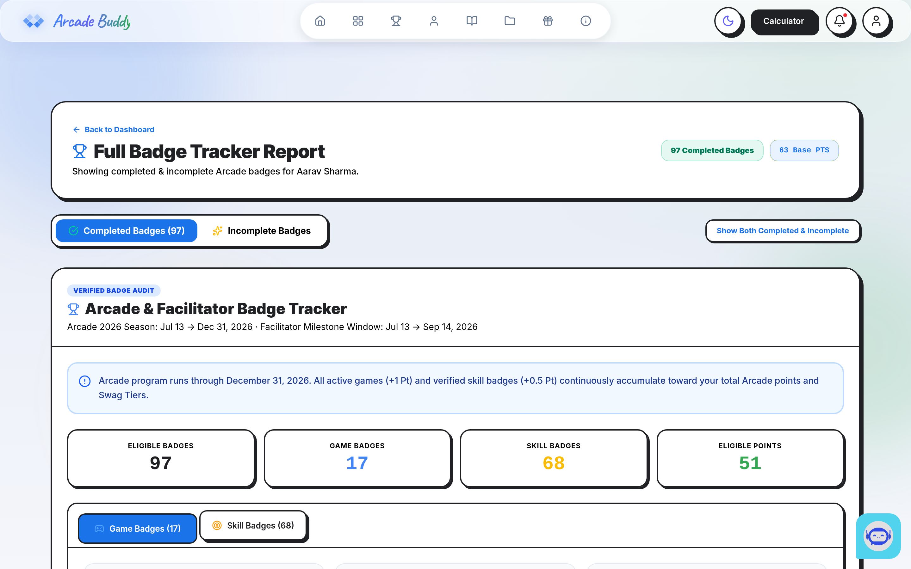

---

### 4. 🧮 Live Points Calculator & Personalized AI Roadmap
Check anyone's Arcade progress in seconds without leaving the browser:
- **Instant Public Profile Analysis**: Paste any Google Cloud Skills Boost public profile URL (or click **Try with demo data** to preview) to inspect points, league rank, badge totals, and tier progress.
- **Cohort Registered Simulation**: Toggle Facilitator enrollment status to see how verified milestone bonus points push total points into higher swag tiers.
- **AI-Powered Personalized Study Roadmap**: Analyzes current Game and Skill badge counts to generate a custom weekly completion schedule and curated lab recommendations paired with an interactive 3D progress globe.

  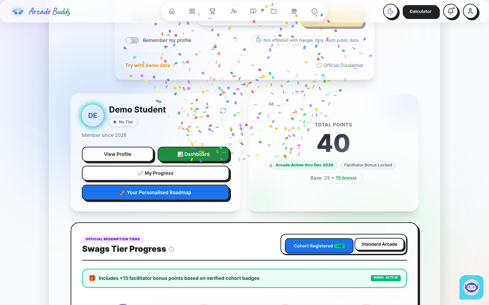

---

### 5. 🏆 Live Community Leaderboard
Monitor global participant progress in one searchable table:
- **Real-Time Rankings**: Lists participants ranked by verified total points alongside Game, Skill, Trivia, and Lab-Free breakdowns.
- **Smart Search & Filters**: Filter instantly by **Participant Name**, **Facilitator Milestone**, **Swag Tier**, and **Access Code Status**, plus track daily **24-hour movement** across the community.
- **Tier Distribution Counters**: Live overview showing how many learners have crossed Trooper, Ranger, Champion, and Legend thresholds.

  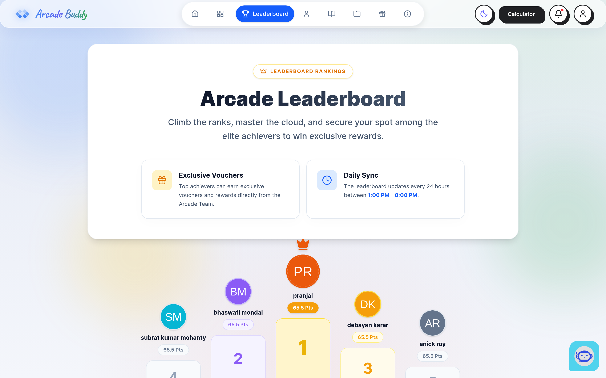

---

### 6. 🎁 Official Swags & Merchandise Catalog
Preview every reward unlocked along the Arcade journey:
- **Soft Pastel Prize Tier Cards**: Clean visual breakdown of **Arcade Trooper (50 PTS)**, **Arcade Ranger (75 PTS)**, **Arcade Champion (95 PTS)**, and **Arcade Legend (120+ PTS)** reward bundles and live remaining Prize Counter spot estimates.
- **Revealed Swag Drops Showcase**: High-resolution cards and specification popups showcasing revealed 2026 items including **The Arcade Vacuum Tumbler**, **The Arcade TechPack**, **The Arcade LumiSnap Magnetic Fill Light**, **Weather-Shield Jacket**, **Wireless Audio Earbuds**, **The Arcade PopUp Pro**, **Arcade Magic Mug**, and **The Arcade Travel Bottle**.
- **Swag Winners Proof Gallery**: Community photo gallery showcasing real delivered merchandise from global past seasons.

| Official Arcade Prize Tiers | Revealed 2026 Swag Drops |
| :---: | :---: |
| 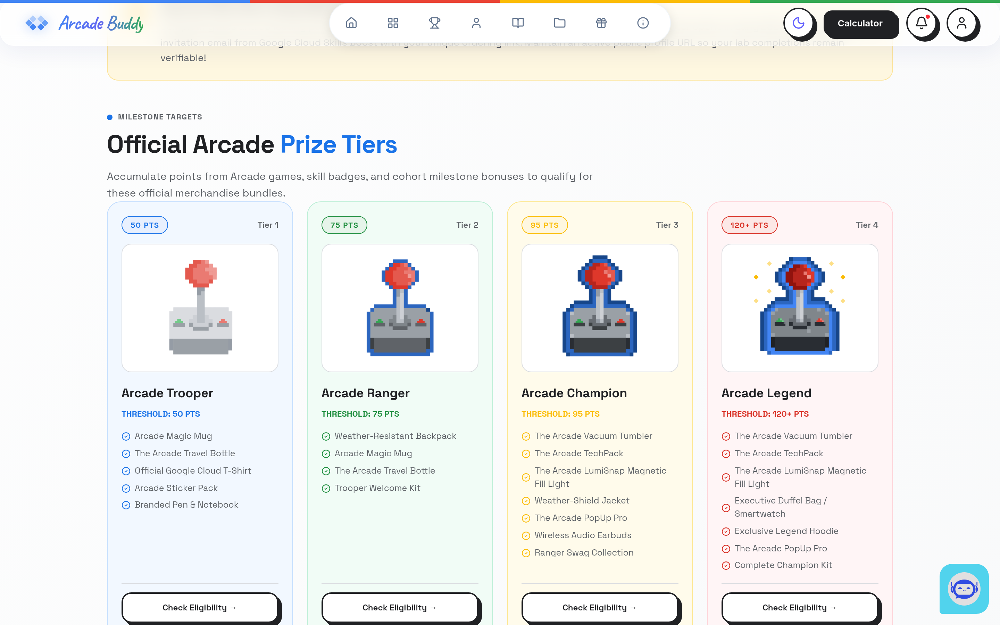 | 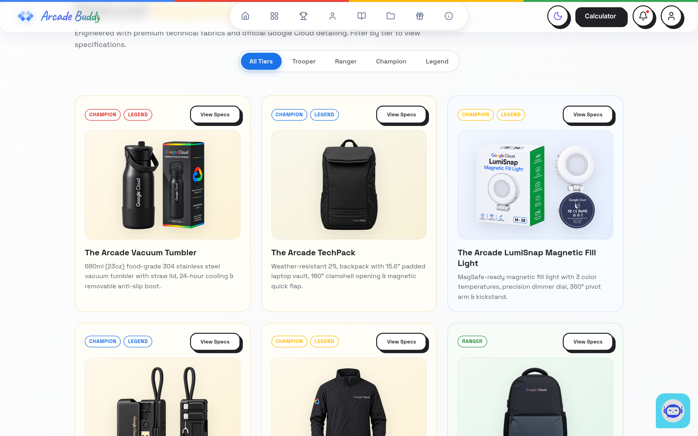 |

---

### 7. 📖 Active Arcade Syllabus & Facilitator Cohort Hub
Everything learners need to know what to complete next:
- **Live & Archived Monthly Quests**: Direct links and copyable access codes for active **November 2026 Arcade Games** (*Diwali in the Arcade*, *Cloud Infrastructure Engineer Simulator*, *Python Apps & Data Analytics Voyage*, and more) alongside **25+ archived past monthly games**.
- **104+ Verified Skill Badges Directory**: Searchable curriculum of introductory, intermediate, and advanced Skill Badges with full-size previews and direct launch links.
- **Facilitator Program Hub**: Complete timeline from **July 13 – September 14, 2026**, bonus milestone tables, and **GEAR Badges** walkthrough (*Program Enrolment Badge* & *Cohort Completion Badge*).

| Active Arcade Syllabus | Facilitator Program Hub |
| :---: | :---: |
| 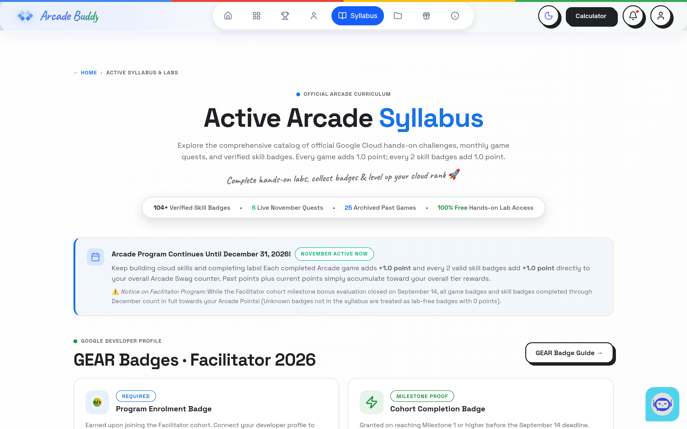 | 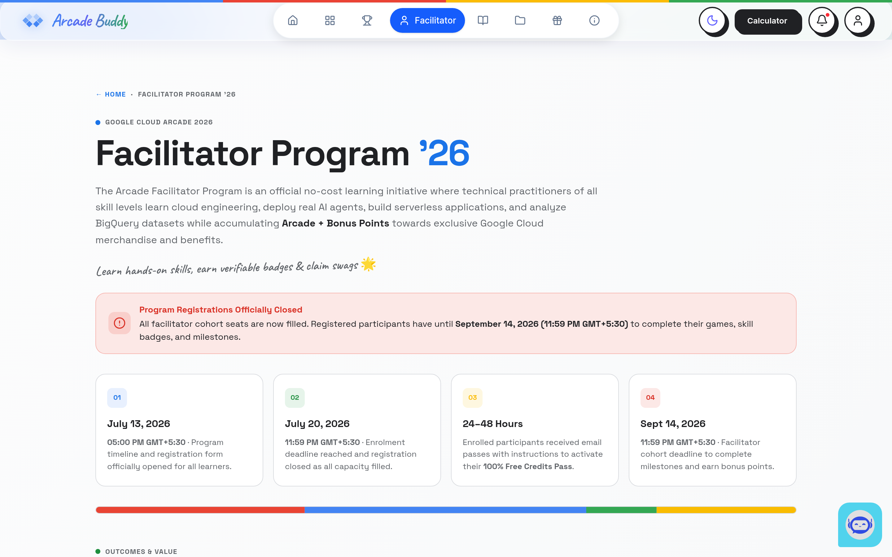 |

---

### 8. 📚 Curated Learning Resources & Step-by-Step Guides
A searchable 14-item knowledge library designed so no learner gets stuck:
- **Prize Counter Redemption & Waterfall System Guide**: Explains how Legend, Champion, Ranger, and Trooper claim waves open sequentially, with a downloadable step-by-step redemption guide.
- **Daily Lab Limit Recovery Guide**: Interactive visual simulator explaining the rolling 24-hour lab quota and cooldown recovery windows.
- **Learn With Communities Event Hub**: Campus event enrollment steps, **200 free Google Skills credits** activation guide, 6-step completion roadmap, and campus community leaderboard.
- **Untrackable Badges Guide (*Work Meets Play*)**: Explains why limited monthly untrackable badges don't auto-appear on calculators and how to claim up to **+7 bonus points**.
- **Quick-Start 2026, Free Cloud Credits & Public Profile Setup Guides**: Clear beginner checklists plus direct links to Master Google Sheets ledgers.
- **24/7 GArcade AI Assistant & Notifications**: Floating AI chatbot answering instant questions about rules, points, and milestones alongside real-time Discourse community announcements and support ticketing.

| Arcade Learning Resources Center | Prize Counter Redemption Guide |
| :---: | :---: |
| 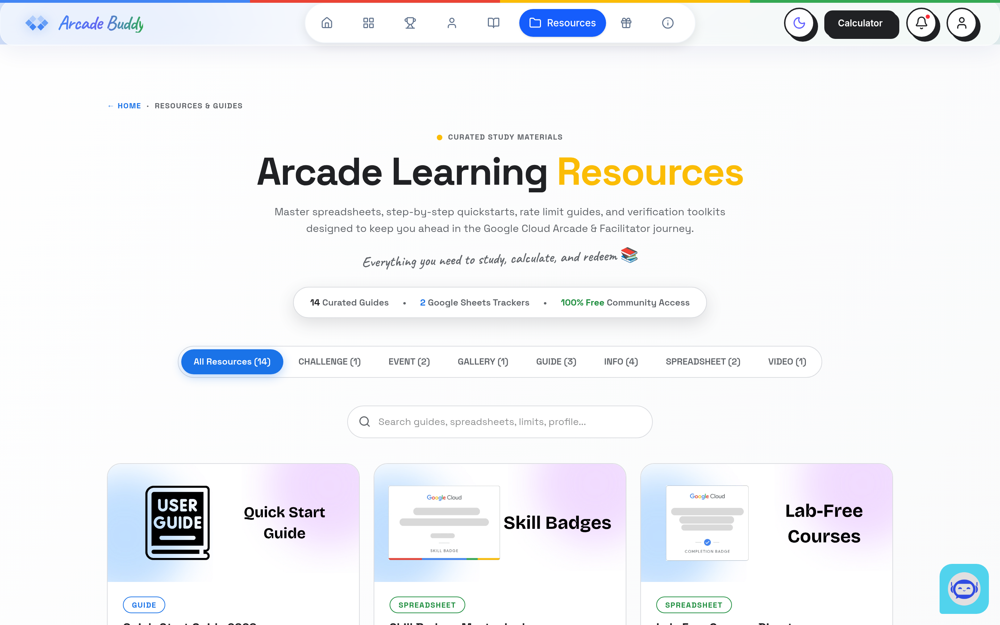 | 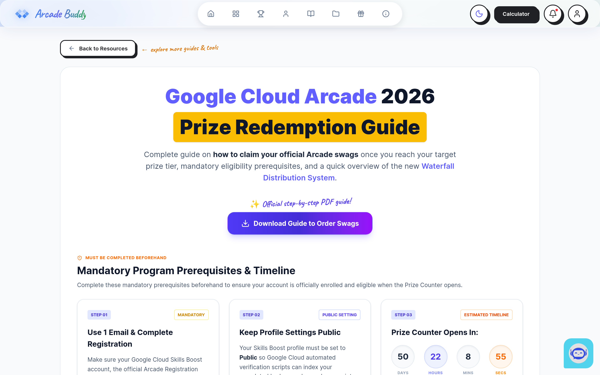 |

---

## 📋 2026 Arcade Rules & Milestones

### Badge Point Values
| Badge Category | Arcade Points | Notes |
|---|---|---|
| 🎮 **Game Badges** | **1.0 pt** | Monthly Arcade games, Adventures, Voyages, Trails & Simulators |
| 🎯 **Skill Badges** | **0.5 pts** | Hands-on challenge labs (every **2** skill badges = **1.0 full point**) |
| ❓ **Trivia Badges** | **1.0 pt** | Weekly and monthly Arcade trivia quizzes |
| 🌟 **Special Badges** | **1.0 pt** | Seasonal events, Work Meet Play & special challenges |
| 📄 **Lab-Free / Completion Badges** | **0.0 pts** | Excluded from standard Arcade & Facilitator point totals |

### Official Swag Tiers (2026)
| Swag Tier | Points Required | Total Global Spots | Included Highlights |
|---|---|---|---|
| 🔵 **Trooper** | **50 PTS** | `6,000` | Magic Mug, Travel Bottle, T-Shirt, Sticker Pack, Pen & Notebook |
| 🟢 **Ranger** | **75 PTS** | `4,000` | Weather-Resistant Backpack + Trooper rewards |
| 🟡 **Champion** | **95 PTS** | `3,000` | Vacuum Tumbler, TechPack, LumiSnap Fill Light, Jacket, Earbuds, PopUp Pro |
| 🔴 **Legend** | **120+ PTS** | `2,500` | Executive Duffel / Smartwatch, Exclusive Hoodie + Champion Collection |

### Facilitator Cohort Bonus Milestones (`Jul 13 – Sep 14, 2026`)
| Cohort Milestone | Games Required | Skill Badges Required | Bonus Points Earned | Stackable Bonus Milestone |
|---|---|---|---|---|
| **Milestone 1** | 6 Games | 18 Skill Badges | **+5 PTS** | Eligible for +10 Bonus Milestone |
| **Milestone 2** | 8 Games | 34 Skill Badges | **+15 PTS** | Eligible for +10 Bonus Milestone |
| **Milestone 3** | 10 Games | 50 Skill Badges | **+25 PTS** | Eligible for +10 Bonus Milestone |
| **Ultimate Milestone** | 12 Games | 66 Skill Badges | **+35 PTS** | Eligible for +10 Bonus Milestone |

---

## 🔒 Privacy & Trust

Arcade Buddy only reads **publicly shared Google Cloud Skills Boost profile pages** and never asks for your Google password or private account credentials. For full details on data handling and platform safeguards, see [**`SECURITY.md`**](./SECURITY.md).

---

## 🤝 Community & Creators

**Designed & Developed by Abir Dey** · **Manitained by Co-Facilitator: Tripti Gupta**
*Google Cloud Arcade Facilitator 2026 — Arcade With Us*

 

**Built with ❤️ for the Google Cloud Arcade Community**
*© 2026 Arcade Buddy · Independent community companion — not affiliated with Google LLC*

