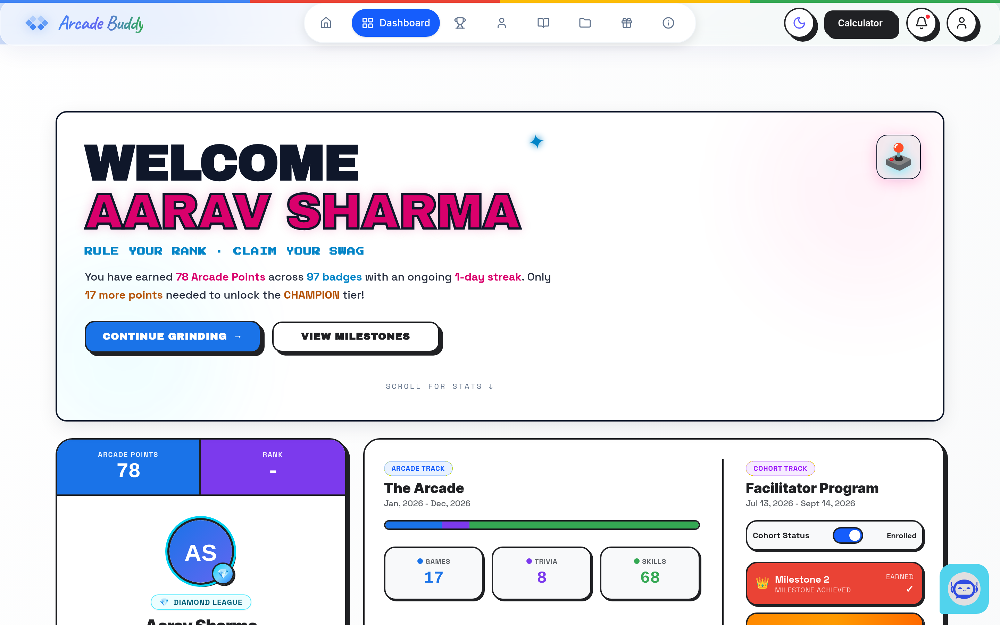
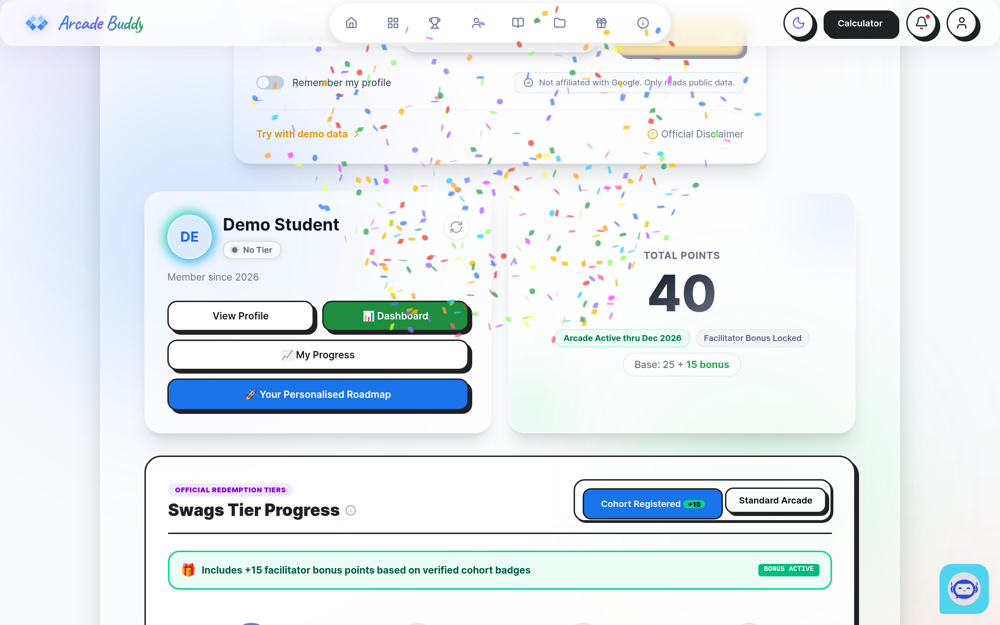
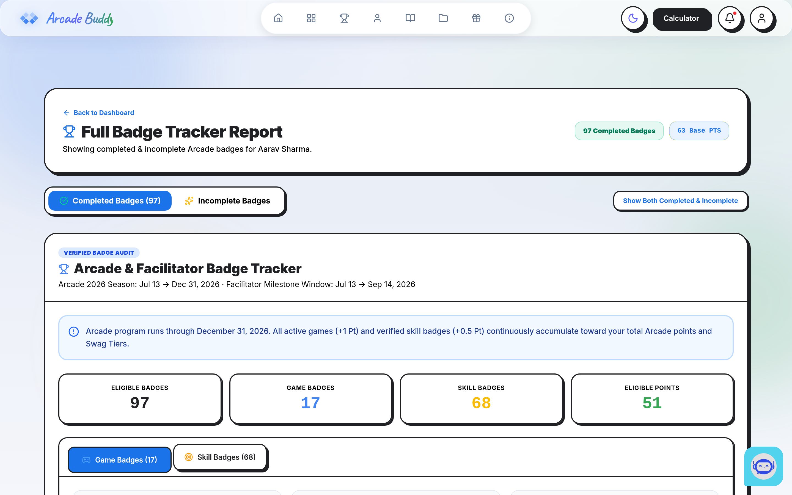
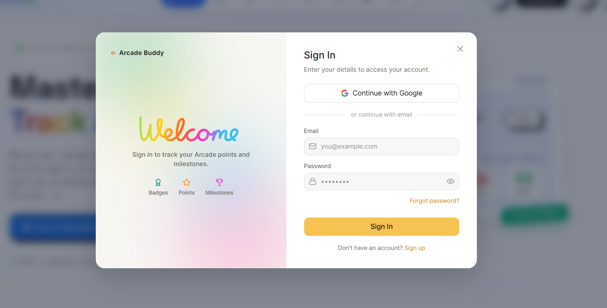
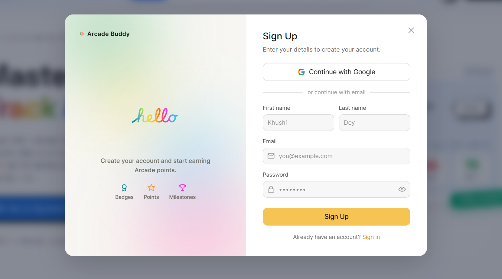

# Security Policy — Arcade Buddy

<div align="center">

**Responsible Disclosure · Defense-in-Depth Architecture · Privacy-First Tracking**

[](./README.md)

</div>

---

## Supported Versions

Security updates and patches are actively applied only to the latest production codebase on `main`:

| Version / Branch | Support Status | Notes |
|---|---|---|
| `main` (Latest Deployment) | ✅ **Actively Supported** | Continuous security patches & dependency updates |
| Older commits / forks | ❌ **Not Supported** | Upgrade to latest `main` before reporting issues |

---

## Reporting a Vulnerability

We take the security of community learners and platform infrastructure seriously. **Do NOT open a public GitHub issue, pull request, or social post for security vulnerabilities.**

### Private Contact Channels

| Channel | Contact Details |
|---|---|
| 📧 **Security Email** | `abirdey.work@gmail.com` |
| 📧 **Support Email** | `abir.facilitator@gmail.com` |
| 💼 **LinkedIn** | [Abir Dey](https://www.linkedin.com/in/abir-dey-a34914254/) |
| 🐙 **GitHub** | [@Babai-69](https://github.com/Babai-69) |

### What to Include in Your Report

Please include concise, reproducible technical details so we can triage rapidly:

1. **Affected Component & Route** (e.g., `/api/calculator`, `firestore.rules`, `/leaderboard`, admin guard, etc.)
2. **Vulnerability Category** (SSRF, XSS, Auth/RBAC bypass, Rate-limit bypass, Secrets exposure, etc.)
3. **Step-by-Step Reproduction** (requests, payloads, or browser steps)
4. **Observed Impact & Severity**
5. **Suggested Remediation** (optional, appreciated)

### Response & Resolution SLA

| Severity | Examples | Initial Acknowledgement | Target Remediation |
|---|---|---|---|
| 🔴 **Critical** | RCE, full auth/RBAC bypass, server secret exposure | Within **24 hours** | **24–72 hours** |
| 🟠 **High** | Cross-user data access, SSRF bypass, privilege escalation | Within **48 hours** | Within **7 days** |
| 🟡 **Medium** | Stored/reflected XSS, validation gaps, CORS misconfiguration | Within **48 hours** | Within **14 days** |
| 🟢 **Low / Info** | Non-sensitive metadata leakage, hardening suggestions | Within **7 days** | Within **30 days / next release** |

---

## Security Architecture & Implemented Controls

Arcade Buddy follows a **defense-in-depth** design across the Express backend (`server.ts`), React frontend (`src/`), and Cloud Firestore (`firestore.rules`).

```
User Browser (React 19 + DOMPurify)
   │
   ├──► Auth & RBAC ──► Firebase Auth (Google Sign-In) ──► firestore.rules (UID + Admin JWT check)
   │
   └──► /api/* (Express 4 behind Trust Proxy)
           ├── Helmet Security Headers + COOP (same-origin-allow-popups)
           ├── Express Rate Limiter (1,000 req / 15 min per IP)
           ├── Zod Schema Validation (/api/chat, /api/notify-query, /api/feedback)
           ├── SSRF URL Allowlist (/api/calculator -> cloudskillsboost / skills.google only)
           └── Server-Side Secret Proxy (GEMINI_API_KEY & SMTP_* never sent to client)
```

### 1. HTTP Headers, Rate Limiting & API Validation (`server.ts`)
- **HTTP Hardening (`helmet`)**: Sets standard security headers with `Cross-Origin-Opener-Policy: same-origin-allow-popups` and `Cross-Origin-Embedder-Policy: unsafe-none` so Firebase Google Sign-In OAuth popups function securely without exposing cross-origin isolation flaws.
- **API Rate Limiting (`express-rate-limit`)**: Protects all `/api/*` routes (`1,000 requests / 15 minutes` per client IP behind `trust proxy`).
- **Strict Schema Validation (`zod`)**:
  - `POST /api/chat`: Enforces bounded prompt lengths (`1–2,000` chars).
  - `POST /api/notify-query`: Validates `name`, `email`, optional `profileUrl` format, `queryType`, and bounded message body (`<= 5,000` chars).
  - `POST /api/feedback`: Validates numeric star ratings (`1–5`) and bounded text inputs.
- **Structured JSON Error Isolation**: Fallback `/api/*` 404 handler and global API error middleware return clean JSON responses without leaking HTML templates or stack traces to clients.

### 2. SSRF Protection on Public Profile Fetching (`/api/calculator`)
Because the calculator fetches external Google Cloud Skills Boost profile pages server-side, `/api/calculator` enforces strict SSRF prevention before making any outbound network call:
- Parses URLs using Node's `URL` constructor and rejects malformed inputs (`HTTP 400`).
- Enforces an explicit **hostname allowlist**: only `www.skills.google`, `skills.google`, `www.cloudskillsboost.google`, and `cloudskillsboost.google` are permitted (blocking internal IPs, cloud metadata endpoints `169.254.169.254`, and arbitrary domains).
- Enforces a strict path check requiring `/public_profiles/<id>` and encodes the extracted ID into a canonical HTTPS upstream URL.
- Caps upstream fetches with an explicit `AbortSignal.timeout(25000)` and cleanly isolates `403`, `404`, `422` (private profile), `429`, `502`, and `504` statuses.

<div align="center">
  
</div>

### 3. Client-Side XSS & Upload Protection
- **DOMPurify Sanitization**: User-rendered rich content and inputs are sanitized using `dompurify` alongside React's built-in JSX escaping.
- **CSV Upload Validation (`TrueLeaderboardPage.tsx`)**: Admin leaderboard CSV imports enforce `.csv` / `text/csv` MIME validation and a strict **10 MB maximum file size** client-side before Firestore batch writes.
- **Client-Side Local Cache Only**: User profile URLs and non-sensitive badge summaries cached in `localStorage` (`arcadeProgressData`) are automatically purged when the user signs out on `/dashboard`.

<div align="center">
  
</div>

### 4. Authentication & Database Authorization (`firestore.rules` & `AccessGuard.tsx`)
All sensitive collections are protected server-side by **Cloud Firestore Security Rules** (`firestore.rules`) paired with `<AccessGuard>` for admin routes (`/admin*`, `/query*`):

| Firestore Collection | Read Access | Write / Update / Delete Access |
|---|---|---|
| `leaderboard/{doc}` | Public (`true`) | **Admin only** (`isAdmin()` via Firebase Auth JWT email check) |
| `users/{uid}` & `users/{uid}/badges/{badgeId}` | **Account owner (`auth.uid == uid`) or Admin** | **Account owner (`auth.uid == uid`) or Admin** |
| `feedbacks/{id}` & `queries/{id}` | **Admin only** (`isAdmin()`) | Create: Public · Read/Update/Delete: **Admin only** |
| `config/{doc}` | Public (`true`) | **Admin only** (`isAdmin()`) |
| `community_leaderboard/{doc}` | Public (`true`) | Open for community coordinators *(tracked for coordinator-UID scoping in future hardening)* |

### 5. Secret & API Key Management
- **Server-Only Secrets**: `GEMINI_API_KEY`, `SMTP_USER`, and `SMTP_PASS` are consumed exclusively inside `server.ts` (`/api/chat`, `/api/roadmap-recommendations`, `/api/notify-query`, `/api/feedback`) and are never exposed to the Vite frontend bundle (`VITE_*`).
- **Public Firebase Web Config**: Client Firebase configuration (`apiKey`, `authDomain`, `projectId`, `appId`) is intentionally public per Firebase Web SDK architecture; access control is enforced server-side by Firebase Auth + `firestore.rules`.
- **Self-Hosting Best Practice**: Always override fallback defaults in production `.env` with unique rotated secrets (`GEMINI_API_KEY`, Gmail App Password for `SMTP_PASS`) and never commit `.env` files to source control.

---

## Security Scope

### ✅ In Scope
- `/api/calculator` URL validation, SSRF protection, and parser safety
- `/api/chat` & `/api/roadmap-recommendations` prompt/input validation & API proxy boundaries
- `/api/notify-query` & `/api/feedback` input validation and email injection prevention
- Firebase Firestore security rules (`firestore.rules`) & admin RBAC checks
- Cross-Site Scripting (XSS) or prototype pollution in React components
- CORS, Helmet headers, or rate-limit bypass vulnerabilities

### ❌ Out of Scope
- Third-party infrastructure vulnerabilities belonging solely to Google Cloud, Firebase, `skills.google`, or Nodemailer upstream providers
- Denial-of-Service / volumetric DDoS testing against live deployments
- Automated vulnerability scanners generating noisy/false-positive traffic
- Social engineering, phishing, or physical access scenarios
- Public exposure of intentionally public Firebase Web SDK identifiers

---

## User Security Best Practices
| Arcade Buddy Login Page | Arcade Buddy Signup Page |
| :---: | :---: |
|  |  |
- **Share Only Public Profile URLs**: Arcade Buddy only requires your public `https://www.skills.google/public_profiles/...` URL — never enter your Google password or account recovery codes anywhere on third-party sites.
- **Zero Credential Storage**: Authentication uses official **Google Sign-In via Firebase OAuth popups**; Arcade Buddy never sees or stores user passwords.
- **No Unsolicited PII on Public Leaderboards**: Public leaderboard entries display participant names, rank badges, and earned point breakdowns only.

---

## Hall of Fame

Responsible researchers who disclose valid security findings will be acknowledged here with their permission:

| Researcher | Finding Summary | Date |
|---|---|---|
| *Open for contributions* | — | — |

---

## Disclaimer & Safe Harbor

Arcade Buddy is an independent community project **not affiliated with, endorsed by, or officially connected to Google LLC**.

We commit not to pursue legal action against security researchers who act in good faith by:
- Reporting vulnerabilities privately and allowing reasonable time for remediation before disclosure.
- Limiting testing strictly to proof-of-concept without accessing, exfiltrating, modifying, or deleting other users' data.
- Avoiding destructive actions or service degradation (DoS/spam).

---

*Maintained by **Abir Dey** · Google Cloud Arcade Facilitator 2026*
